# Stall Changes Model: Spec & Implementation Plan

**Audience:** Parts 1 to 5 are written for business review (no code knowledge needed). Part 6 is the technical appendix for developers.

**Status:** Draft for review.

---

# Part 1: Summary

## What is changing

Today, when someone adds a stall, they fill in a **blank** form. When they edit a stall, they edit **their own previous submission**. Each submission is a full list of foods, and moderators merge it into the polling place by hand. The merge can only add foods. It can't remove them.

The new model starts from **what is already approved** for the polling place. The user then **adds** foods or **removes** foods, and the submission records only those changes. A moderator approves it, and the change is applied to the place.

## Why

- People can tell us a food is no longer at a stall. Today they can't.
- Every change to a place is traceable: who, when, and from which submission.
- The map, the place pages and the exports are not affected.

## When

The old model is **replaced completely**, not run alongside the new one. The switch happens **after the current election closes and before the next one opens**. Overlapping elections don't happen in practice, so a clean gap exists.

## Today versus the new model

| | Today | New model |
|---|---|---|
| Add a stall: starting point | Blank form | Foods already approved for the place |
| What a submission records | A full list of foods | Only the foods added and removed |
| Removing a food | Not possible. A moderator edits the place by hand | A user can submit a remove, and a moderator approves it |
| Edit your own stall | Your previous full list | The current approved state with your own changes on top |
| Moderator merge | Automerge can only add foods | Moderator edits a pre-merged form that includes removes |
| Two people disagree | The moderator spots it by eye | The admin warns about base changes and newer conflicting submissions |
| Record of changes | Place history, with no add/remove detail | Place history with add/remove detail and the source submission |
| Past elections | Full-list submissions | Left as read-only add-only snapshots |

## What is out of scope

- Free text, name, description, opening hours and website. They keep working as today.
- Saying which stall at a place sells which food.
- Trust scoring, or auto-approving removes.

---

# Part 2: Glossary

| Term | Meaning |
|---|---|
| **Nom** | A food option. The six tickable ones are bbq, cake, bacon and eggs, halal, vego and coffee. |
| **Approved state** | The foods currently approved for a polling place in an election. This is what the map shows. |
| **Claim** | One statement a user makes: "add cake" or "remove bacon and eggs". |
| **Change** (also "diff") | The set of claims in one submission. |
| **Submission** | One stall submitted by a public user, pending until a moderator approves or declines it. |
| **Corroborating claim** | A claim that matches what is already true, for example adding cake when cake is already approved. |
| **Moderator** | An admin who reviews submissions. |
| **Owner link** | The emailed link that lets a submitter edit their own submission. |
| **Tip-off** | A report from someone who isn't running the stall. |
| **Run out** | A flag saying a stall has sold out. |
| **"Nothing" / Red Cross of Shame** | A flag saying there's definitely no stall at this place. |

---

# Part 3: How it works (user journeys)

## 3.1 A public user adds a stall

1. They pick the election, their role and the polling place.
2. The form shows the foods **already approved** for the place. For example bacon and eggs is shown as already listed.
3. For each food they can leave it alone, or tap to change it:
   - An **unlisted** food cycles: unchanged, then **add**, then unchanged.
   - A **listed** food cycles: unchanged, then **remove** (cross icon), then unchanged.
4. Each state is shown with an icon and colour, and has a screen-reader label.
5. Foods they leave alone say **nothing**. Leaving bacon and eggs alone is not a vote that it's still there.
6. They fill in the name, description and other details, which start blank as today.
7. They submit. The submission goes to the moderators as **pending**.

**Rules on submitting**
- They must make at least one real change (a food add or remove, or free text).
- Name and description are still required.
- They can't remove every listed food and add nothing. They're told to submit a "no stall" tip-off instead.
- Tapping a food on and then off again counts as no change.

**What users never see:** pending changes from other people. They see approved state only.

## 3.2 A moderator reviews a submission

1. The pending list works as today.
2. The review screen shows each add and each remove. **Removes are clearly highlighted.** For a remove, it lists which stalls at the place currently claim that food.
3. The moderator edits the place form, which starts with the change already applied, and saves. They can change anything before saving, so they can accept part of a submission by editing.
4. They can decline instead. A declined submission has no effect.

**Warnings the moderator sees**
- **Base changed:** "Since this was submitted, bacon and eggs was removed by another stall."
- **Newer conflict:** "A newer submission on the same food is pending or was approved."
- **Retraction:** if an owner has edited an earlier claim, it shows as "retracting the earlier removal".
- **No-stall override:** adding food to a place currently marked "nothing" needs explicit confirmation.

**If the place changes while the moderator is reviewing:** their save is rejected, the screen reloads with the new state, and they re-review.

## 3.3 A stall owner edits their own submission

1. The emailed link opens the owner's submission.
2. The form shows the **current approved state with the owner's own changes shown on top**. A removal they made appears with the cross icon.
3. If someone else has since reversed one of their claims (another stall re-added bacon and eggs), the form shows the owner's claim with a one-line note: *"Your submission removed this, but another stall has since re-added it."*
4. Saving puts the submission back to **pending** for re-approval, as today.
5. If the owner drops a claim they previously made, approval treats it as the **opposite claim**. Un-removing bacon and eggs becomes an explicit add, so the place reflects the retraction.

Editing stops once the election ends. This is the existing behaviour.

## 3.4 Tip-offs

| Type | What happens |
|---|---|
| **Ordinary tip-off** | Uses the same form as an owner, with a "how do you know" source field. |
| **Run out** | Unchanged form: the user ticks the foods the stall had. These are recorded as add-only claims. Approval also sets the "run out" flag. Election day only. |
| **Definitely no stall** | Unchanged. Approval marks the place "nothing" and earlier changes are superseded. Election day only. |

Run-out and no-stall tip-offs can't be edited by the person who submitted them.

## 3.4a Screenshots of the current system

Captured from the running apps with fake data (a school with bacon and eggs and cake approved). Mobile width.

**Add a stall: who is submitting?** Only two options show here because "run out" and "no stall" are election-day only.

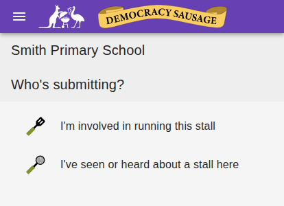

**Add a stall: owner form.** Every food starts unticked and every field blank, even though the place already has approved foods. The new model starts from the approved foods instead.

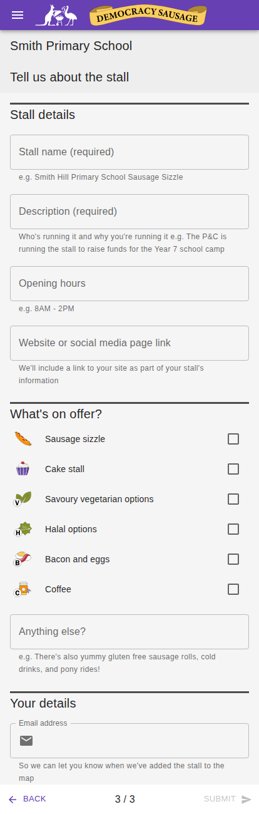

**Edit a stall.** The form is prefilled from the owner's *own earlier submission* (only bacon and eggs is ticked), not from what is currently approved for the place (which also includes cake). The new model starts from the approved state and shows the owner's own claims on top.

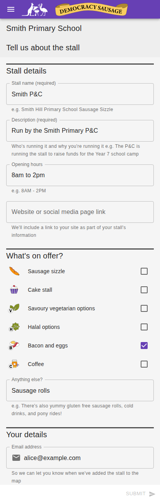

**Moderator review: the submission.** The moderator sees a text diff of the submission against what is approved today (green added, red struck out). The new model makes the food changes explicit adds and removes.

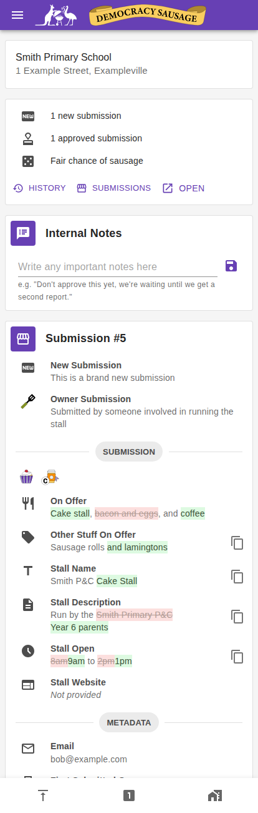

**Moderator review: the merge form.** The moderator edits the approved data and saves. This stays as the single place approval happens in the new model, pre-merged with the submission's changes.

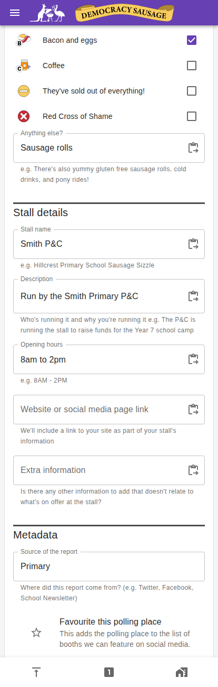

## 3.5 Screen mockups (indicative only)

Final visual design is still open. These show the intended content and states. Each screen is shown twice: a hand-sketched version (for discussing the idea) and a clean version in the app's style (for judging how it would look). Plain-text versions follow for reference.

**1. Public form: before and after tapping.** Bacon and eggs and cake are approved. The user taps bacon and eggs once (remove) and coffee once (add). Untouched foods make no claim.

| Sketch | Clean |
|---|---|
| 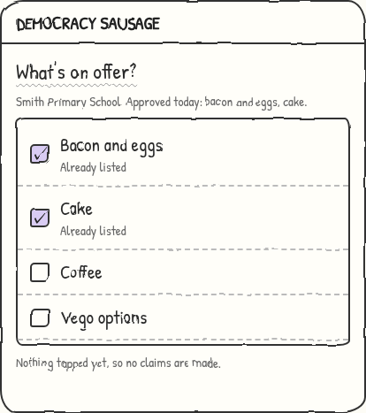 | 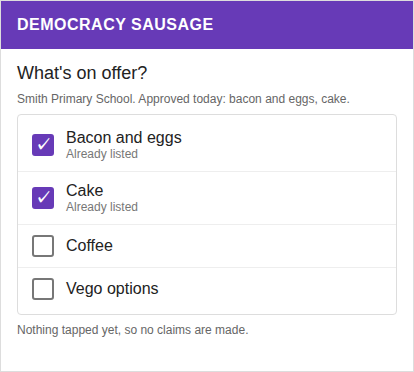 |
| 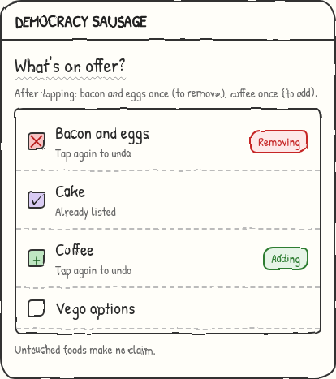 | 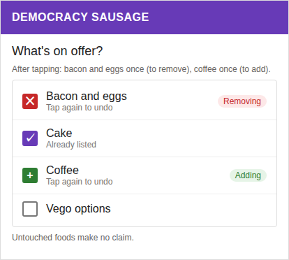 |

**2. Owner edit, when another stall has reversed a claim.**

| Sketch | Clean |
|---|---|
| 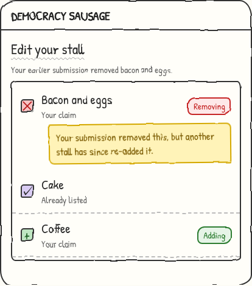 | 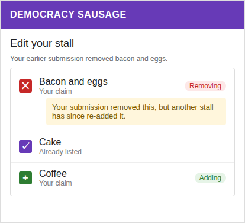 |

**3. Moderator review: diff and warnings.**

| Sketch | Clean |
|---|---|
| 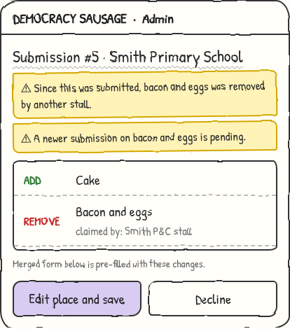 | 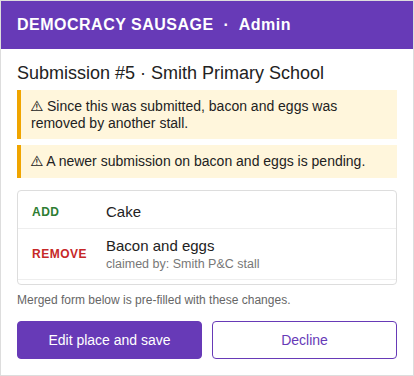 |

**4. Moderator review: the merge form.** The moderator edits a pre-filled form. Foods are already adjusted for the submission's changes, and each change is labelled.

| Sketch | Clean |
|---|---|
| 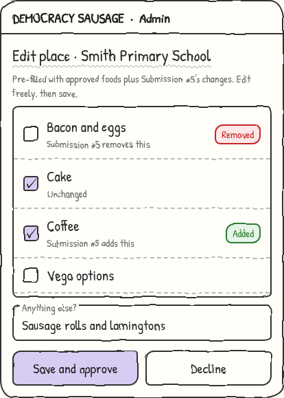 | 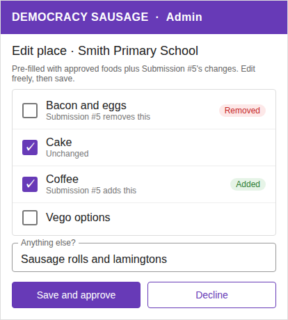 |

**5. Moderator review: a stale save is rejected.** Someone else changed the place while the moderator was reviewing. Nothing is saved, and the form reloads.

| Sketch | Clean |
|---|---|
| 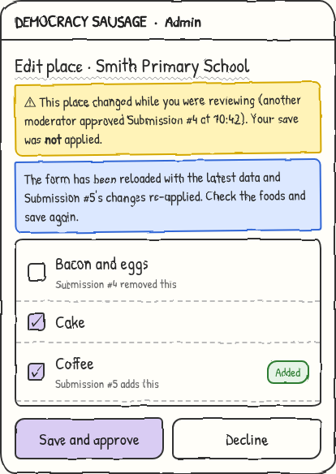 | 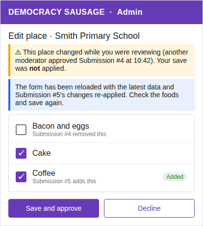 |

**6. Free text.** Free text isn't part of the add/remove model. The moderator sees what's approved next to what was submitted, and decides what's saved.

| Sketch | Clean |
|---|---|
| 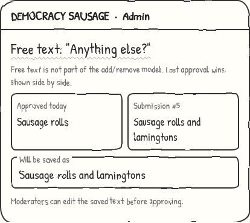 | 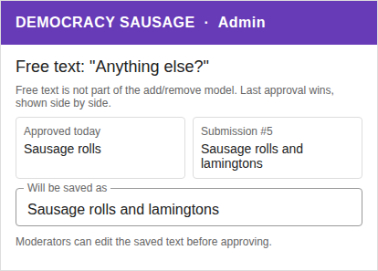 |

**7. Ordinary tip-off.** It uses the same tap-to-change form as an owner's submission, plus the tip-off source and email.

| Sketch | Clean |
|---|---|
| 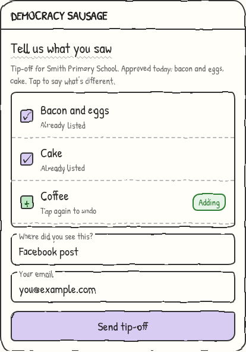 | 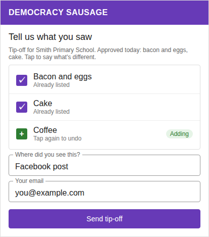 |

**8. Run-out tip-off.** The form is unchanged: tick the foods the stall had. These are add-only claims, and approval also sets the sticky "run out" flag.

| Sketch | Clean |
|---|---|
| 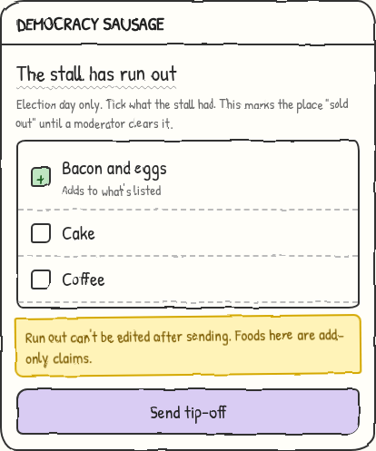 | 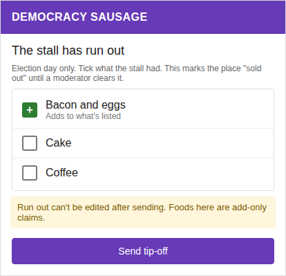 |

**9. Adding a food to a place marked "no stall".** The moderator is asked to confirm before the "no stall" status is replaced.

| Sketch | Clean |
|---|---|
| 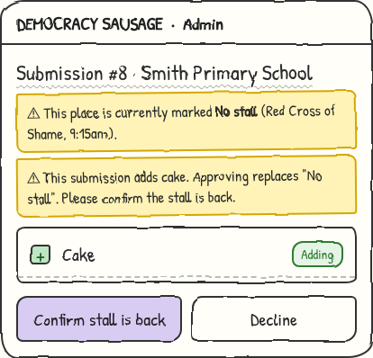 | 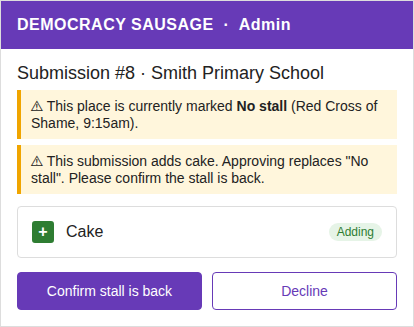 |

**10. How a food's state changes.** Every state has an icon and a spoken label, so it never depends on colour alone.

| Sketch | Clean |
|---|---|
| 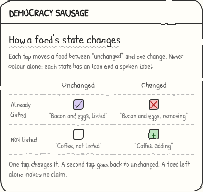 | 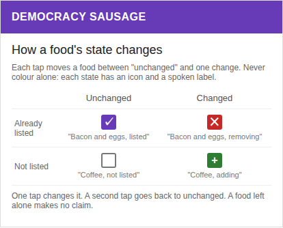 |

Plain-text versions:

**Public form: food options** (bacon and eggs is approved, cake is not)

```
Food options
┌──────────────────────────────────────────────┐
│ [✓] Bacon and eggs            Already listed │   <- unchanged
│ [ ] Cake                                     │   <- unchanged
│ [ ] Coffee                                   │
└──────────────────────────────────────────────┘

After tapping bacon and eggs once and cake once:
┌──────────────────────────────────────────────┐
│ [✕] Bacon and eggs     Removing (not there)  │   <- remove claim
│ [+] Cake                    Adding           │   <- add claim
│ [ ] Coffee                                   │
└──────────────────────────────────────────────┘
Tap again to undo. Untouched foods make no claim.
```

**Owner edit: a claim someone else has reversed**

```
┌──────────────────────────────────────────────┐
│ [✕] Bacon and eggs     Removing              │
│     Your submission removed this, but another│
│     stall has since re-added it.             │
└──────────────────────────────────────────────┘
```

**Admin review: diff and warnings**

```
Submission from alice@example.com (owner)

⚠ Since this was submitted, bacon and eggs was removed by another stall.
⚠ A newer submission on bacon and eggs is pending.

Changes
  ADD     Cake
  REMOVE  Bacon and eggs     (claimed by: Smith P&C stall)

[ Edit place and save ]   [ Decline ]
```

## 3.6 Acceptance criteria

Each criterion should be checked by a reviewer.

**Adding a stall**
- Given a place with bacon and eggs approved, when I open the add form, then bacon and eggs shows as already listed.
- Given an approved food, when I tap it once, then it shows as a remove claim, and when I tap it again, then it returns to unchanged.
- Given I changed nothing and left name and description blank, when I submit, then it is blocked.
- Given I have removed every approved food and added nothing, when I submit, then it is blocked and I'm pointed to the "no stall" tip-off.
- Given I left a food alone, when the submission is saved, then it says nothing about that food.
- Given someone else's pending change on the place, when I open the form, then I see approved state only.

**Moderating**
- Given a submission with a remove, when I review it, then the remove is highlighted and the stalls claiming that food are listed.
- Given the place changed after the submission, when I review it, then I see a "base changed" warning.
- Given a newer submission on the same food, when I review it, then I see a warning.
- Given the place changed while I was editing, when I save, then the save is rejected and the form reloads.
- Given a submission that adds food to a place marked "nothing", when I approve it, then I must explicitly confirm.
- Given I decline a submission, then the place is unchanged and the submission is kept as declined.

**Owner edits**
- Given my approved removal, when I reopen my link, then my removal shows with the cross icon.
- Given another stall has since re-added that food, when I reopen my link, then I also see the one-line note.
- Given I drop my earlier removal and it's approved, then the food is added back to the place.
- Given the election has ended, when I open my link, then I can't edit.

**Tip-offs and special flags**
- Given a run-out tip-off is approved, then the place is flagged as run out and later approved changes don't clear the flag.
- Given a "no stall" tip-off is approved, then the place shows "nothing" and earlier changes are superseded.
- Given a corroborating claim, when it's approved, then the place is unchanged and the claim is recorded and counted in the submitter's contributions.

---

# Part 4: Business rules and why

| # | Rule | Why |
|---|---|---|
| 1 | The base is the approved foods for the place **in that election**, blank if none. | Each election is a fresh start, so last election's foods aren't carried over. |
| 2 | Untouched foods make no claim. | An implicit "still there" would add claims users didn't consciously make. |
| 3 | A moderator must approve every change, including removes. | Removes are a stronger and more abusable claim than adds. |
| 4 | Removes get no extra scrutiny beyond being highlighted. | Keeps moderation simple. The moderator sees who else claims the food. |
| 5 | **The order of approval decides conflicts.** The latest approved claim on a food wins. | Simple and predictable, and the moderator is warned about newer conflicting submissions. |
| 6 | A moderator hand-edit counts as a claim and is recorded as theirs. | The record must show every change, whoever made it. |
| 7 | An owner's changes remain "live": they're replayed whenever the owner reopens their link. | The owner sees what they actually claimed. |
| 8 | A claim that matches what is already true is **kept** and counted. | It's corroborating evidence and still a contribution. |
| 9 | Run out is **sticky**. Only a moderator clears it, by editing the place by hand. | It's a status for the day, not a food, and shouldn't clear accidentally. |
| 10 | Free text, name, description, hours and website behave as today. | They describe the stall, not the place. Last approval wins for free text. |
| 11 | A remove targets the place's combined foods. The moderator judges plausibility. | Places can have several stalls, and we don't record which stall sells what. |
| 12 | Declined submissions stay on record, with no effect. The owner can still edit and resubmit. | It matches today's behaviour. |
| 13 | At election end the record is kept as a read-only archive. | It's useful history and nothing else needs to happen. |

---

# Part 5: Worked examples and decisions to confirm

## Example A: Two stalls disagree (rule 5)

At Smith Primary, bacon and eggs and cake are approved.

- **Mon:** Alice submits "remove bacon and eggs". A moderator approves it. The place now shows cake only.
- **Tue:** Bob submits "add bacon and eggs". A moderator approves it. The place shows both again.
- **Wed:** Alice opens her link. Her form shows bacon and eggs with the **cross icon** and the note that another stall has re-added it.
- If she saves, her removal is re-submitted as a new claim. If approved, it wins again.

## Example B: Older claim approved later (rule 5)

- **Mon:** Alice submits "remove bacon and eggs".
- **Tue:** Bob submits "add bacon and eggs" (newer, and perhaps more reliable).
- **Wed:** A moderator approves Bob's, then Alice's.
- The place ends up **without** bacon and eggs, because Alice's was approved last. The moderator is warned that a newer conflicting submission existed.

## Example C: Stale review (section 3.2)

On Tuesday you submit "add cake". On Wednesday another stall's removal of bacon and eggs is approved. On Thursday the moderator sees your submission with a warning about the Wednesday change.

## Example D: Corroborating claim (rule 8)

Cake is approved. Bob loaded his form earlier and also submits "add cake". Nothing changes on the place, but his claim is recorded and counts towards his contributions.

## Decisions to confirm

These are the judgement calls most worth a business check.

1. **Approval order beats submission time** (Example B). An older claim can override a newer one. Is that acceptable, given the warning?
2. **Removes get no extra scrutiny.** There's no trust threshold for first-time or anonymous submitters. Is that acceptable?
3. **Owners keep re-submitting a stale removal** (Example A). The note appears, but nothing prevents re-submitting it.
4. **Corroborating claims count in contribution stats.** Is it right for them to score the same as claims that change something?
5. **Run out is cleared by hand only.** Could a stuck "run out" flag mislead the public if a moderator forgets?
6. **No one-click undo for a mistaken "no stall".** Moderators re-enter the foods by hand.
7. **Removing everything is blocked.** Users must use the "no stall" tip-off, which is election day only. Is that too restrictive on other days?
8. **Public API change.** The `/stalls/` data will show claims (adds and removes), not full food lists. Does anything outside the app rely on it?
9. **Blank start for each election.** The first submitter sees no suggestions from the previous election.
10. **Timing.** All work must land in the gap between elections. Is the available window big enough?

## Review checklist

Please mark each line **OK**, **Change** (with a note) or **Question**. Decision numbers refer to the list above.

| # | Question | OK | Change | Question |
|---|---|---|---|---|
| 1 | Approval order decides conflicts, even if an older claim overrides a newer one. | ☐ | ☐ | ☐ |
| 2 | Removes get no extra scrutiny (no trust threshold). | ☐ | ☐ | ☐ |
| 3 | Owners can re-submit a removal another stall has reversed. | ☐ | ☐ | ☐ |
| 4 | Corroborating claims score the same in contribution stats. | ☐ | ☐ | ☐ |
| 5 | "Run out" is cleared by hand only. | ☐ | ☐ | ☐ |
| 6 | No one-click undo for a mistaken "no stall". | ☐ | ☐ | ☐ |
| 7 | Removing every food is blocked outside election day. | ☐ | ☐ | ☐ |
| 8 | The public `/stalls/` API shows claims, not full food lists. | ☐ | ☐ | ☐ |
| 9 | Each election starts from a blank base. | ☐ | ☐ | ☐ |
| 10 | The between-elections window is long enough. | ☐ | ☐ | ☐ |
| 11 | The mockups in section 3.5 show the right content and wording. | ☐ | ☐ | ☐ |
| 12 | The acceptance criteria (3.6) are testable and complete. | ☐ | ☐ | ☐ |
| 13 | The risks table covers what worries you (see "What could go wrong"). | ☐ | ☐ | ☐ |
| 14 | Questions in "Open questions" are ones you can answer, or know who can. | ☐ | ☐ | ☐ |

Anything missing or wrong that isn't covered above:

## Operational impact

**Moderators**
- The review screen changes: removes are highlighted and warnings appear. Moderators need a short briefing and a how-to note.
- Expect new work in judging removes, and in deciding conflicts when warnings appear.
- A wrong "no stall" and a stuck "run out" flag are still fixed by editing the place by hand.

**Public users**
- The add and edit forms look different, because they now show approved foods and a tap-to-remove control. Help text on the form should explain what each state means and that leaving a food alone says nothing.
- An owner who reopens a link will see their earlier claims. The reversed-claim note needs plain wording.

**Emails**
- The submitted, approved and edited emails currently list foods. They'll describe the user's claim instead ("You added cake and removed bacon and eggs"). Wording needs sign-off.

**Launch**
- The change goes live in the gap between elections, so no live submissions are affected.
- The public `/stalls/` API changes shape. Any outside consumer needs notice. We don't yet know whether one exists.
- Past-election submissions stay viewable by admins as add-only snapshots.

## What could go wrong

| Risk | Likelihood and impact | What limits it | Still exposed |
|---|---|---|---|
| A malicious or mistaken **remove** deletes a real food. | Medium likelihood, public-facing impact. | A moderator approves every change, removes are highlighted, and the review shows who else claims the food. | A moderator may approve a plausible-looking remove without checking. |
| **Two stalls disagree** and the wrong claim wins. | Medium, wrong food shown until fixed. | Approval order decides, with warnings about newer conflicting submissions. | An older claim can override a newer one (decision 1). |
| A moderator **saves from a stale view**. | Medium on busy days. | A stale save is rejected and the form reloads. | A moderator may be confused by the reload. |
| A **"no stall" tip-off is wrong** (a prank or a mistake). | Low, high impact on election day. | Moderator approves it, and a later add asks for confirmation. | No one-click undo (decision 6). |
| A **"run out" flag is left on**. | Medium, misleads the public after the stall restocks. | Only a moderator clears it, by editing the place. | Nothing reminds a moderator to clear it (decision 5). |
| **Stats are inflated** by corroborating claims. | Medium, low impact. | Claims are counted deliberately. | Totals no longer mean "changes made" (decision 4). |
| An outside consumer **breaks on the API change**. | Unknown. | Notice to consumers before launch. | We don't yet know whether any exist (see below). |
| **Cut-over runs over** into the next election. | Low, high impact. | Work lands in the gap between elections. | The size of the window is unconfirmed. |
| Users **don't understand** the tap-to-remove control. | Medium. | Icons, labels, spoken labels and form help text. | Needs a check with real users before launch. |

## Open questions

These can't be answered from the code. Each needs an owner.

| # | Question | Why it matters | Who can answer |
|---|---|---|---|
| 1 | Does anything outside the app use the public `/stalls/` API? | Its shape changes (decision 8). | Project owner |
| 2 | How long is the gap between elections available for the cut-over? | The work must fit inside it (decision 10). | Project owner |
| 3 | Who signs off the new email wording? | Emails describe the user's claim instead of listing foods. | Project owner |
| 4 | Who briefs moderators, and when? | The review screen changes. | Moderator lead |
| 5 | Is a trial with a few real users wanted before launch? | Tap-to-remove is new to the public. | Project owner |

---

# Part 6: Technical appendix

## 6.1 Scope of the diff

| Field | Behaviour |
|---|---|
| `bbq`, `cake`, `bacon_and_eggs`, `halal`, `vego`, `coffee` | Diffed (add / remove) against the approved `PollingPlaceNoms` |
| `free_text` | Outside the model: blank on add, own submission on edit, last approval wins |
| name, description, opening hours, website | Outside the model, stall-level as today |
| `nothing` | Place-level status, set only by the "no stall" tip-off |
| `run_out` | Sticky place-level flag, never touched by diffs |

`nothing`, `run_out` and `free_text` share the `noms` JSON with the foods, so the diff covers only the six checkbox keys.

## 6.2 Data model

- **`PollingPlaceNoms`** stays authoritative, so all readers are unchanged.
- **`Stalls.noms`** (new model): the user's claim as adds and removes for the six checkbox noms. Free text and other fields stay on the stall.
- **`PollingPlaceNoms` history** (simple_history) is extended with structured add/remove detail and a reference to the source submission. Admin edits, approvals, the loader and unofficial-place creation all write a log entry.
- **Pending and declined diffs** live on the submission, not in history, which only records applied changes.
- **Past-election submissions** remain add-only snapshots, read-only. Edit links are already disabled after an election. No conversion.
- **Stats:** `getGamifiedElectionStats` reads history, which won't record a corroborating claim that changes nothing. It must also count approved claims (submission diffs plus moderator edits).
- Code that describes or displays submissions must handle both shapes (snapshot and diff).

## 6.3 Submission logic

- **Create / `update_and_resubmit`:** validate the claim and normalise it (a nom tapped back to its original state is no change). Keep corroborating claims. Enforce at least one real change.
- The form tracks changes against the base, so "tap twice" is resolved client-side.
- **Edit replay:** the form base is current approved state with the owner's stored diff applied. A claim that disagrees with the current state is shown with the reversed-claim note.
- **Retraction:** on re-approval, a claim present in the previous approved diff but absent from the edited one becomes the opposite explicit claim.
- **Tip-offs:** ordinary tip-offs use the diff form. Run out stores add-only claims, and the server sets `run_out: true` as today, but approval no longer replaces the foods. "No stall" sets `nothing`, writes a log entry and supersedes earlier diffs.
- **Add onto a `nothing` place:** flagged, and approval requires explicit moderator confirmation.

## 6.4 Approval and concurrency

- Approval stays a moderator edit of a pre-merged place form followed by a save. The server derives the real add/remove delta from what was saved and logs it. The existing change reasons (`APPROVED_AUTOMATIC`, `APPROVED_MANUAL`) still record whether the result matched the submission.
- The place row is locked (`select_for_update`) during the write, as the unofficial stall views already do.
- A save is rejected if the place changed since the moderator loaded the form. The response lets the UI reload and re-review.
- The "no edits made" and "doesn't appear merged" safeguards are rewritten to compare against the diff, including removes.
- Automerge is extended to handle removes. Conflicts are surfaced through the two warnings in section 3.2.

## 6.5 Polling places without a polling place record

Stalls with only `location_info` have no approved base. Their first submission is all adds. Unofficial stall approval creates the place and its `PollingPlaceNoms`, after which later users amend it as a normal base. Matching an unofficial stall to an official place leaves it pending for normal triage. These flows are otherwise unchanged.

## 6.6 Impact on existing consumers

| Consumer | Impact |
|---|---|
| Public map GeoJSON, place and detail APIs, CSV export, chance-of-sausage analytics | None, provided approval still saves `PollingPlaceNoms` |
| Cache and map regeneration (signals) | None, for the same reason |
| Approve flows (`stall_views.approve`, `stall_unofficial_views`) | Change: apply the diff instead of replacing from a snapshot |
| Admin pending lists, diff display, automerge and merge checks | Change: interpret diffs and removes |
| Approved and edited emails (`getFoodDescription`) | Change: describe the user's own claim ("You added cake and removed bacon and eggs"). Handle old snapshots too |
| Public `/stalls/` API | Change: exposes the claim, which is a contract change |
| Submission counts, submitter-email analysis | None |

Cached frontends need no special handling. After an election ends the API already rejects submissions and edits.

## 6.7 Rejected alternatives

- **Dual models behind a per-election flag:** more code paths, and unnecessary because the cut-over falls between elections.
- **Diffs as the truth, with place noms as a projection:** a heavier change to every reader.
- **Implicit "still there" from untouched noms:** untouched noms would then make claims.
- **Per-stall nom diffs:** correct for multi-stall places, but too complex for the benefit.
- **Submission time deciding conflicts:** older claims could never override newer ones, but approval order is simpler.
- **Retire or expiry actions for diffs:** not needed. Diffs end by being superseded or at election end.
- **One-click revert of a wrong "no stall":** not needed.
- **A separate diff-log table:** extending history keeps stats and history views working.

## 6.8 Implementation plan

Work back from the next election's opening date. All phases land in the gap between elections.

### Phase 1: Schema and shared logic
- Define the diff shape and validation for the six checkbox noms.
- Extend `PollingPlaceNoms` history with add/remove detail and the source submission.
- Shared functions: compute a diff from base and final state, apply a diff, replay an owner's diff, and detect conflicts (base changed, newer conflicting claim).
- Tests, following `.github/instructions/testing.instructions.md`.

### Phase 2: Backend submission and approval
- Create and `update_and_resubmit`: validate, normalise, and enforce the submit rules.
- Both approve flows: lock the place, reject stale saves, derive and log the delta, set change reasons.
- Tip-off handling, and the `nothing` override confirmation.
- Other writers (admin direct edits, loader, unofficial-place creation) write log entries.
- Update the stats query to count approved claims.

### Phase 3: Public frontend
- Add and edit forms: prefill from approved state, the toggle with icon, colour and screen-reader labels, the submit rules, and blocking "remove everything".
- Owner edit: replay the owner's diff and show the reversed-claim note.
- Ordinary tip-offs use the diff form. Run-out and no-stall forms are unchanged.

### Phase 4: Admin frontend
- Diff display with highlighted removes and the list of stalls claiming each nom.
- Warnings: base changed, newer conflicting submission, `nothing` override, retractions.
- Rewrite the merge safeguards and handle stale-save rejection.
- Free text side by side.

### Phase 5: Emails, API and old data
- Rewrite `getFoodDescription` and the approved and edited emails, handling both shapes.
- Update the `/stalls/` serializers for the claim.
- Make past-election submissions render correctly as add-only snapshots.

### Phase 6: Rollout
- Verify end to end against test data: multiple stalls at one place, unofficial places, and all three tip-off types.
- Ship in the gap between elections, before the next one opens.

## 6.9 Open items for implementation

- Exact JSON shape for diffs on `Stalls.noms`.
- Visual design of the toggle states and the reversed-claim note.
- Wording of the admin warnings.
